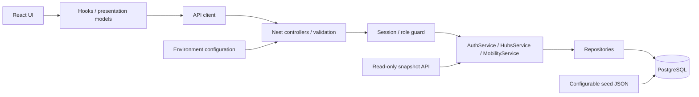
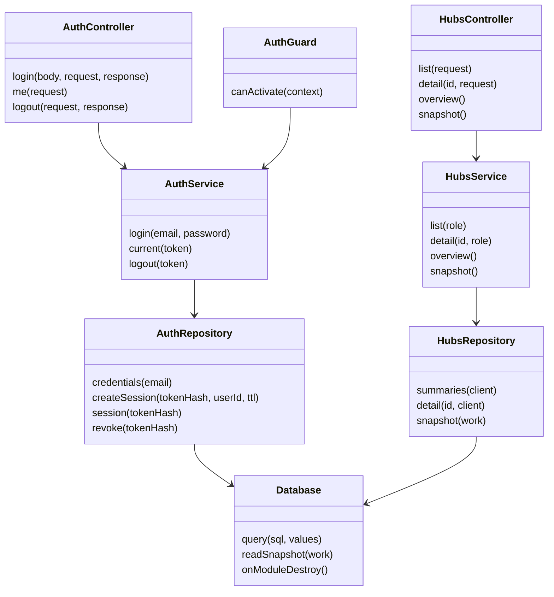
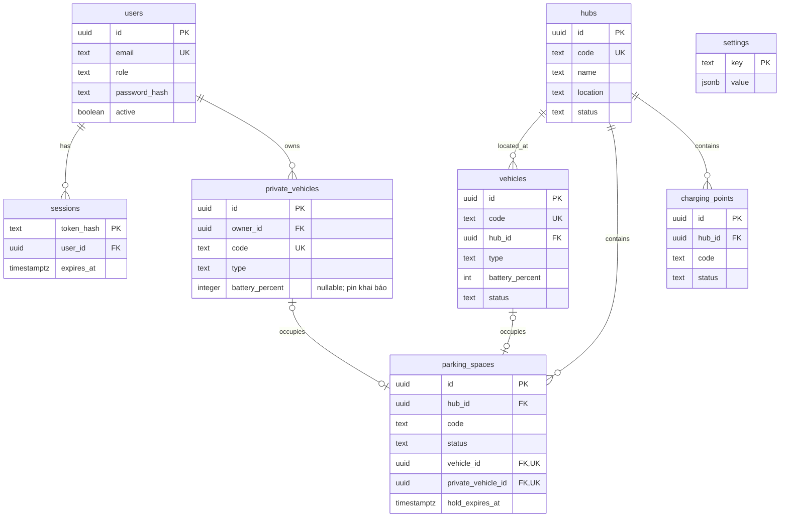
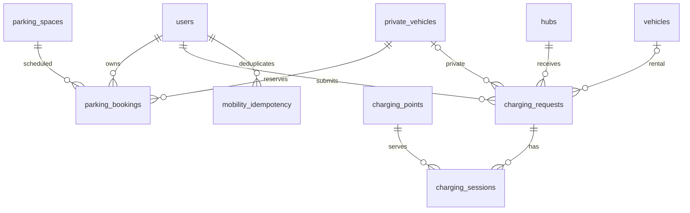
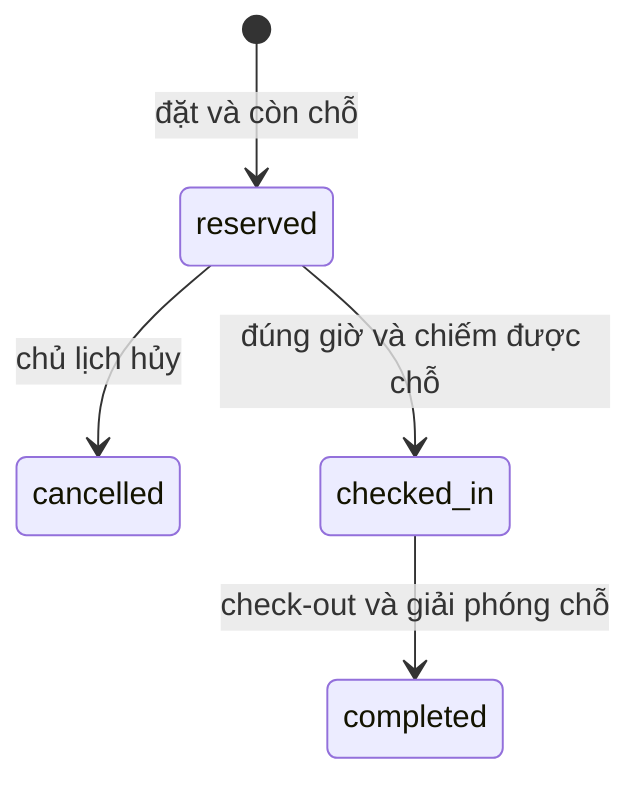
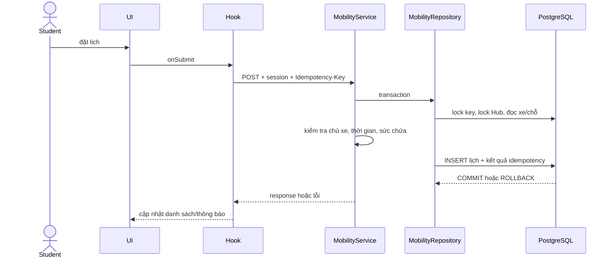
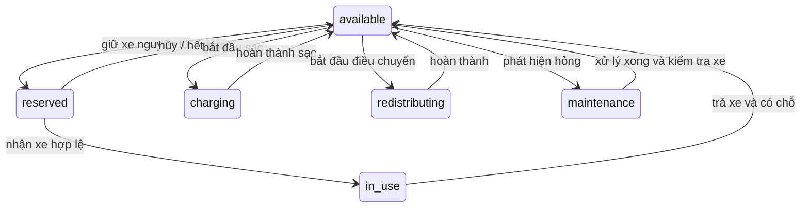

# Kiến trúc và dữ liệu nền tảng

Sơ đồ này phản ánh bản đang triển khai. Các module nghiệp vụ chưa có code được liệt kê riêng trong tài liệu API và bàn giao.

Auth guard chạy trước controller; public endpoints được đánh dấu rõ. HubsService lọc theo role và tổng hợp overview; repositories chứa SQL. Kiểu response dùng chung ở packages/contracts là contract thuần, không chứa code backend.

Chọn một backend theo module để ghép công việc của 5 người và demo local đơn giản. Đánh đổi: các module triển khai cùng một ứng dụng; migration/hợp đồng cần review chung. Chưa cần microservice hoặc message broker.

## Class diagram nền tảng

Các dependency được inject bằng Nest. Class diagram này chỉ mô tả module đang có code; chưa bao gồm các class thuộc nhiệm vụ TV2–TV5.

## ERD đã triển khai

Vehicle hub_id có thể null khi đang đi; quan hệ Hub/vehicle thực tế là tùy chọn phía vehicle. Một chỗ occupied chứa đúng một xe thuê hoặc cá nhân. `(hub_id,code)` unique với chỗ đỗ/cổng sạc; FK đã có index phù hợp. Database chặn pin ngoài 0–100 và trạng thái không hợp lệ.

Schema chưa có constraint kiểm tra xe đỗ cùng Hub; caller và allocation service phải giữ invariant này trong transaction. Migration 002 bổ sung bảng đặt chỗ và exclusion constraints; base schema 001 riêng vẫn không phải cơ chế chống đặt trùng đầy đủ.

## Mai Anh — dữ liệu và hành vi tuần 1

charging_requests có đúng một trong vehicle_id/private_vehicle_id; partial unique index chặn hai yêu cầu active cho cùng xe. charging_sessions mới có schema/constraint cho tuần 2, chưa có scheduler hay API chạy phiên. parking_bookings có starts_at/ends_at và exclusion constraints theo chỗ/xe cho reserved/checked_in; lịch tương lai không cập nhật trạng thái parking_spaces.

Trong triển khai HTTP thực, request đi qua global auth guard và controller/DTO trước service. Xem docs/api.md và docs/guides/CONTRIBUTING.md cho chính sách chỗ vật lý và điểm tích hợp AllocationPort.

## Vòng đời dự kiến cho TV2

Các chuyển trạng thái trên là baseline thiết kế, chưa phải service đã chạy. Trường hợp sự cố khi reserved/in_use/charging cần chủ module thiết kế thêm; không cho phép cập nhật status tùy ý.

## Thuê xe: reservation và trip (T06, migration 003)

- `vehicle_reservations`: `active → cancelled | expired | fulfilled`; unique index một lượt `active` cho mỗi xe; `closed_at` chỉ có khi đã kết thúc.
- `trips`: `active → completed`; một reservation tạo tối đa một trip (`reservation_id UNIQUE`); trip `completed` bắt buộc có `ended_at`, Hub đích và pin cuối.
- Quy tắc trạng thái nằm ở `apps/api/src/rental/rental.rules.ts`; trạng thái xe đổi theo sự kiện reserve/cancel/expire/pickup/return và phải cập nhật có điều kiện (`WHERE status = from`).
- Settings cần có: `reservationHoldMinutes`, `minimumRentalBatteryPercent` (seed trong `database/seed.example.json`).
