# Kiến trúc và dữ liệu nền tảng

Sơ đồ này phản ánh bản đang triển khai. Phạm vi module đã triển khai và còn chờ được phân biệt tại tài liệu API và báo cáo T14.

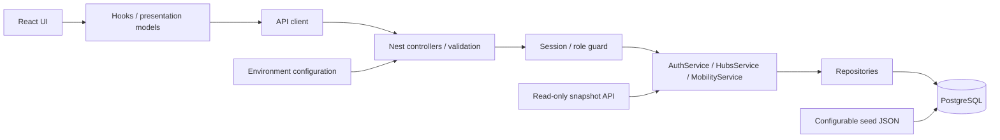

Auth guard chạy trước controller; public endpoints được đánh dấu rõ. HubsService lọc theo role và tổng hợp overview; repositories chứa SQL. Kiểu response dùng chung ở packages/contracts là contract thuần, không chứa code backend.

## T15 — refresh dashboard và thay đổi quyền (20/10/2026)

Logic nằm trong `useFoundation`; UI chỉ hiển thị dữ liệu và nối handler. Polling, nút làm mới, tab visible và mạng trở lại dùng cùng một khóa request. Danh tính/role được đọc lại trước tài nguyên; backend guard vẫn kiểm tra từng request. Reset phía UI làm các hook phụ thuộc user dọn dữ liệu phiên cũ, không gọi logout thay cho người dùng.

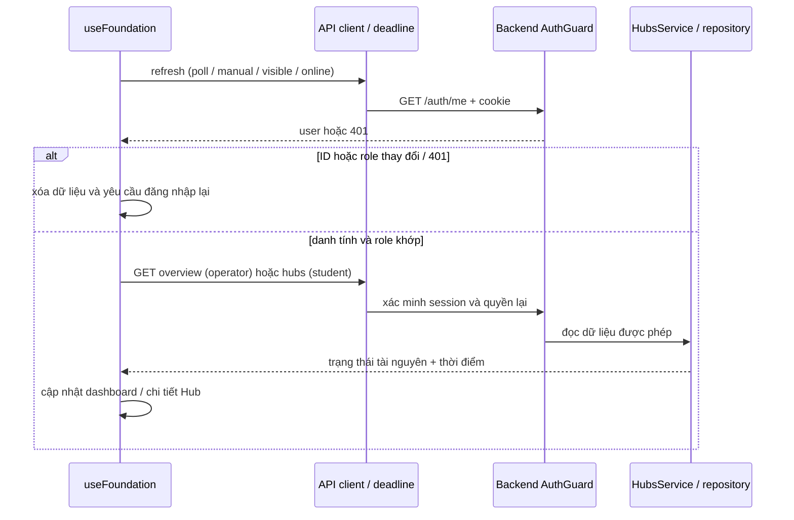

Nếu request tài nguyên trả 403, UI xóa cache; mạng/5xx giữ dữ liệu và timestamp cũ kèm lỗi. `ErrorFilter` chuẩn hóa `{statusCode, code, message}`, che message nội bộ cho mọi 5xx. Không thêm bảng, migration hoặc endpoint.

Chọn một backend theo module để ghép công việc của 5 người và demo local đơn giản. Đánh đổi: các module triển khai cùng một ứng dụng; migration/hợp đồng cần review chung. Chưa cần microservice hoặc message broker.

## Class diagram nền tảng

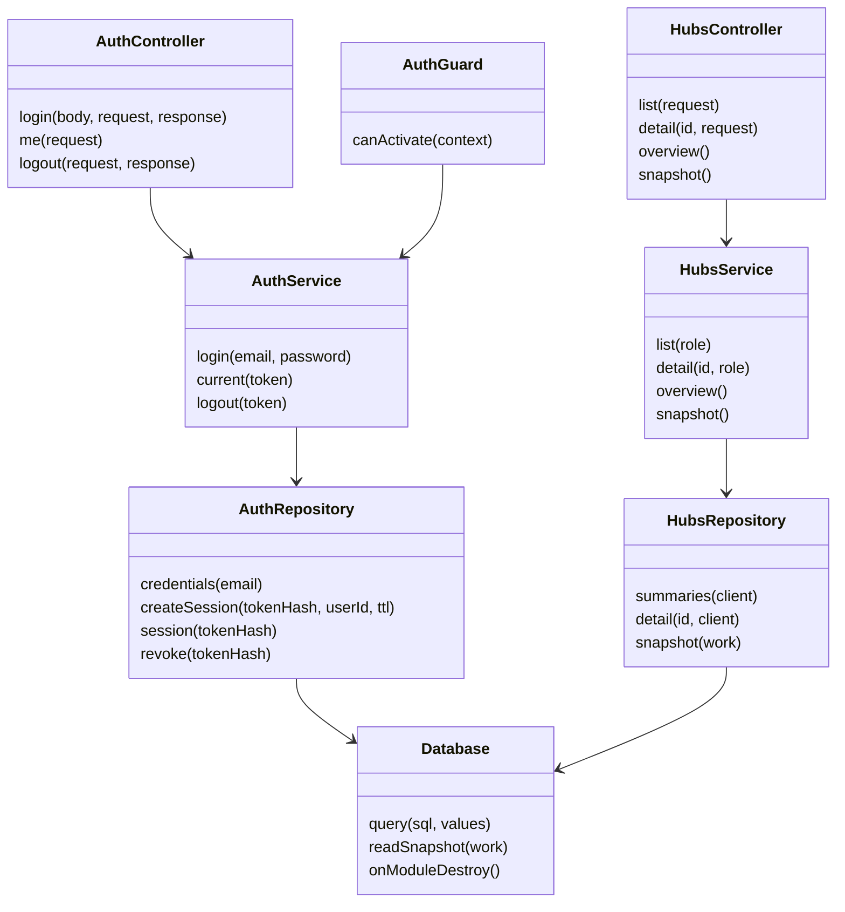

Các dependency được inject bằng Nest. Class diagram này chỉ mô tả lớp nền tảng; các module rental, mobility, operations và simulation đã có code được bổ sung ở các phần sau.

## ERD đã triển khai

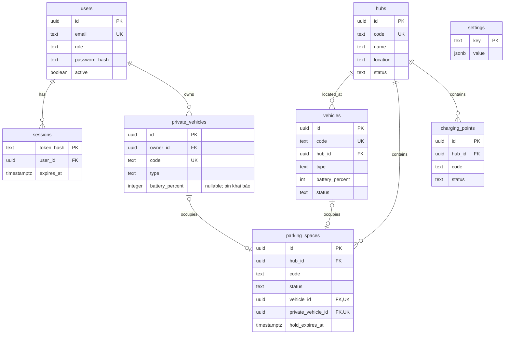

Vehicle hub_id có thể null khi đang đi; quan hệ Hub/vehicle thực tế là tùy chọn phía vehicle. Một chỗ occupied chứa đúng một xe thuê hoặc cá nhân. `(hub_id,code)` unique với chỗ đỗ/cổng sạc; FK đã có index phù hợp. Database chặn pin ngoài 0–100 và trạng thái không hợp lệ.

Schema chưa có constraint kiểm tra xe đỗ cùng Hub; caller và allocation service phải giữ invariant này trong transaction. Migration 002 bổ sung bảng đặt chỗ và exclusion constraints; base schema 001 riêng vẫn không phải cơ chế chống đặt trùng đầy đủ.

## Mai Anh — dữ liệu và hành vi tuần 1

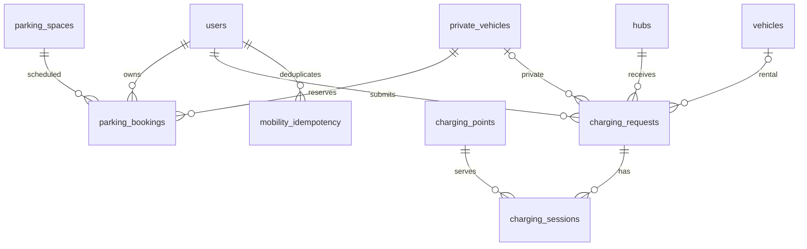

charging_requests có đúng một trong vehicle_id/private_vehicle_id; partial unique index chặn hai yêu cầu active cho cùng xe. charging_sessions mới có schema/constraint cho tuần 2, chưa có scheduler hay API chạy phiên. parking_bookings có starts_at/ends_at và exclusion constraints theo chỗ/xe cho reserved/checked_in; lịch tương lai không cập nhật trạng thái parking_spaces.

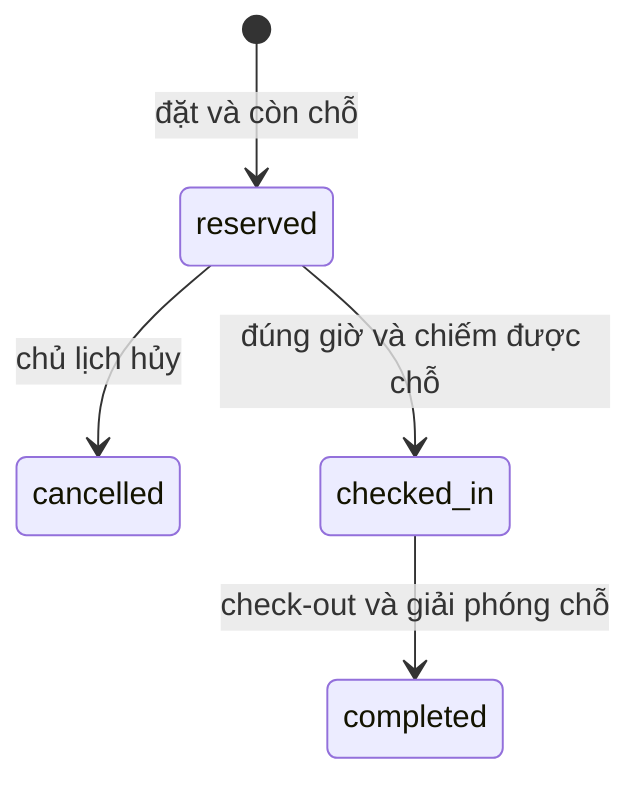

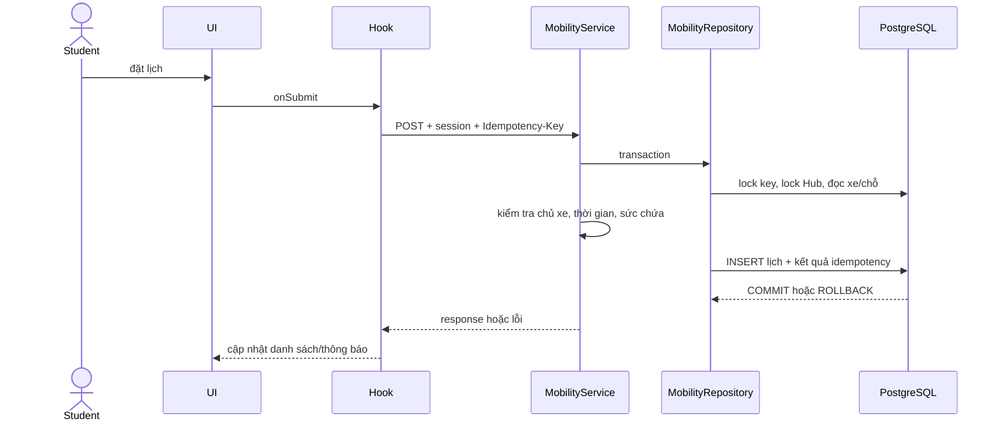

Trong triển khai HTTP thực, request đi qua global auth guard và controller/DTO trước service. Xem docs/api.md và docs/guides/CONTRIBUTING.md cho chính sách chỗ vật lý và điểm tích hợp AllocationPort.

## Vòng đời dự kiến cho TV2

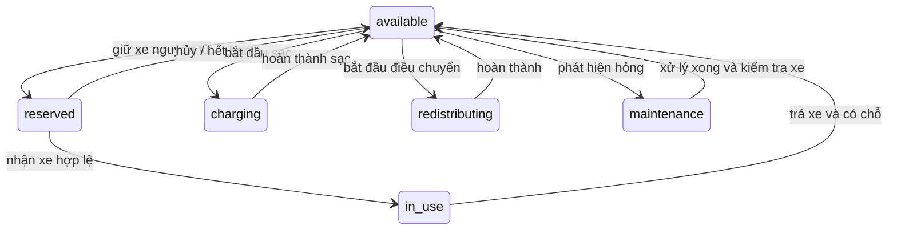

Các chuyển trạng thái trên là baseline thiết kế, chưa phải service đã chạy. Trường hợp sự cố khi reserved/in_use/charging cần chủ module thiết kế thêm; không cho phép cập nhật status tùy ý.

## Thuê xe: reservation và trip (T06, migration 003)

- `vehicle_reservations`: `active → cancelled | expired | fulfilled`; unique index một lượt `active` cho mỗi xe; `closed_at` chỉ có khi đã kết thúc.
- `trips`: `active → completed`; một reservation tạo tối đa một trip (`reservation_id UNIQUE`); trip `completed` bắt buộc có `ended_at`, Hub đích và pin cuối.
- Quy tắc trạng thái nằm ở `apps/api/src/rental/rental.rules.ts`; trạng thái xe đổi theo sự kiện reserve/cancel/expire/pickup/return và phải cập nhật có điều kiện (`WHERE status = from`).
- Settings cần có: `reservationHoldMinutes`, `reservationExpirySweepSeconds`, `minimumRentalBatteryPercent` (seed trong `database/seed.example.json`).

## T13 Simulation

SimulationPanel → useSimulation → simulationApi → SimulationController (operator) → SimulationService → HubsService.snapshot() + SimulationRepository (chỉ đọc settings) → engine thuần departures-v1. Không thêm bảng/migration; kết quả chỉ trả cho client. Xem simulation.md về model và giới hạn.

## T07/T12 sau tích hợp 18/10/2026

Đặt/hủy: UI → useRental/useReservations → API client có deadline → ReservationService → RentalRepository/RentalTx → PostgreSQL. Xác nhận hủy nằm trong hook; component chỉ render và nối sự kiện. Phản hồi mutation từ tài khoản cũ không thay đổi UI của phiên mới.

Sự cố/điều chuyển: OperationsController → DTO → OperationsService → OperationsRepository. Service giữ điều kiện nghiệp vụ; repository giữ SQL/transaction. OperationsService gọi RentalService với cùng PoolClient để khóa và chuyển xe `available → redistributing`; không tự cập nhật bảng vehicles. Hub được khóa theo ID, xe theo ID để các lệnh cạnh tranh tuần tự. Cập nhật xe và order nằm trong cùng transaction.

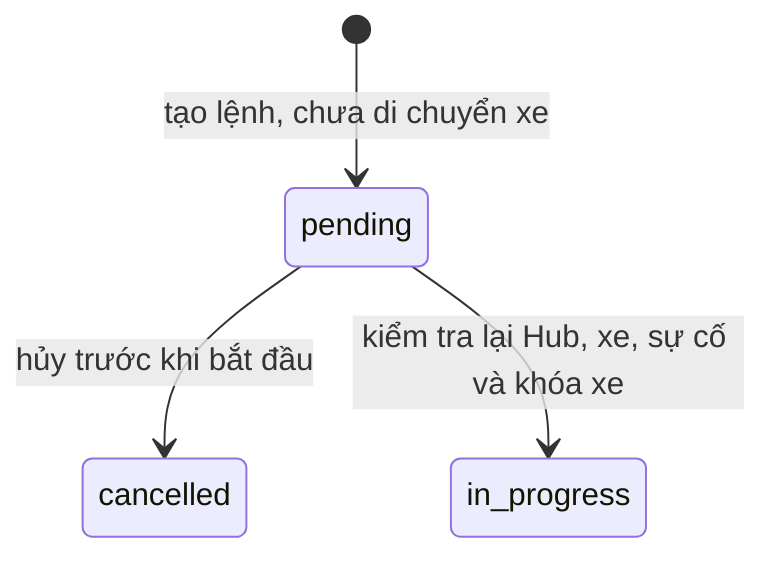

Đây là phạm vi T12: chưa có endpoint hoàn tất/hoàn tác lệnh đang chạy hoặc UI quản trị. `in_progress` giữ vị trí/chỗ nguồn cho đến workflow di chuyển thực tế ở task tiếp theo; không tự chiếm chỗ đích. Incident hiện là nhật ký open/resolved; không tự chuyển Hub inactive, xe maintenance hay cổng failed, và không tự xử lý reservation/trip/charging. Tác động của sự cố lên vận hành theo BR-08/BR-10 cần service của chủ module triển khai tiếp. Chưa có Idempotency-Key cho T07/T12; client không tự retry mutation.

## T08 — tích hợp nhận/trả xe

ReservationController/TripController → TripService → RentalRepository/RentalTx → PostgreSQL. TripService gọi AllocationPort của MobilityModule với cùng PoolClient; không tự cập nhật chỗ đỗ. Thứ tự khóa ở nhánh cấp/giải phóng là Hub → xe → chỗ, sau khi đã khóa reservation/trip riêng của thao tác. Cách này tránh vòng khóa ngược với các caller Hub-first; kiểm tra contention trên PostgreSQL nằm trong trip.test.mjs.

Frontend App chỉ nối props/handlers: useRental điều phối đặt/hủy/nhận/trả và refresh; useTrips giữ trạng thái tải/mutation theo generation của tài khoản; useTripTarget giữ Hub đích riêng theo tripId. TripPanel hiển thị mọi chuyến active. Phản hồi mutation của phiên cũ không sửa lỗi, gợi ý hoặc mở khóa mutation của phiên mới. Giữ simulation, mobility, dashboard retry và request deadline khi giải quyết conflict PR #8.

```mermaid
sequenceDiagram
  actor Student
  participant Hook as useRental / useTrips
  participant Trip as TripService
  participant Tx as RentalTx / PostgreSQL
  participant Allocation as AllocationPort
  Student->>Hook: nhận xe
  Hook->>Trip: POST pickup + session
  Trip->>Tx: BEGIN; khóa reservation, Hub nguồn, xe
  Trip->>Allocation: giải phóng chỗ (cùng PoolClient)
  Trip->>Tx: reservation fulfilled; xe in_use; INSERT trip; COMMIT
  Trip-->>Hook: TripView
  Hook->>Hook: tải lại xe/chuyến/dashboard
  Student->>Hook: trả xe vào Hub đã chọn
  Hook->>Trip: POST return + targetHubId
  Trip->>Tx: BEGIN; khóa trip, Hub đích, xe
  Trip->>Allocation: chiếm chỗ hợp lệ (cùng PoolClient)
  alt đủ điều kiện
    Trip->>Tx: hoàn tất trip; xe available tại đích; COMMIT
    Trip-->>Hook: TripView
  else không đủ chỗ / Hub inactive
    Trip->>Tx: ROLLBACK
    Trip-->>Hook: 409 + suggestedHubs từ cấu hình
  end
```

Đã có tự động hết hạn T16; chưa có kiểm tra pin sau khi đã giữ xe hoặc telemetry T17; không coi phạm vi T08 là toàn bộ hardening tuần 2.

## T14 — ranh giới module trên một bản tích hợp

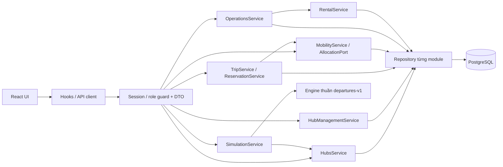

Trip và allocation dùng cùng PoolClient để xe/chỗ/trip commit nguyên tử. Operations chỉ gọi RentalService để giữ xe khi start; chưa hoàn tất điều chuyển. Simulation đọc snapshot nhất quán và settings, engine không truy cập DB; không áp dụng kết quả lên vận hành. T35 đã có UI → useHubManagement → API → HubManagementService → HubManagementRepository. CRUD/cấu hình layout không chuyển trạng thái vận hành của xe hay phiên sạc. Mutation khóa Hub; xóa cổng khóa tiếp cổng trước kiểm tra incident để đồng bộ với Operations. Capacity đọc giới hạn từ settings; giữ nguyên booking/lịch sử và rollback nếu không đủ chỗ xóa an toàn.

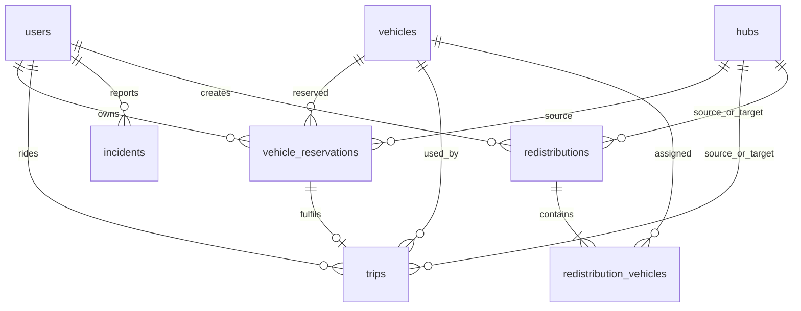

ERD trên bổ sung quan hệ các bảng migration 002 operations và 003 rental; cột/constraint chi tiết vẫn theo SQL đã chia sẻ. `incidents.resource_id` là tham chiếu đa hình được service kiểm tra theo resource_type, không phải FK trực tiếp tới một bảng duy nhất. Bảng charging_sessions đã có schema nhưng chưa có vòng đời chạy phiên; không suy từ ERD ra tính năng đã hoàn thành.
