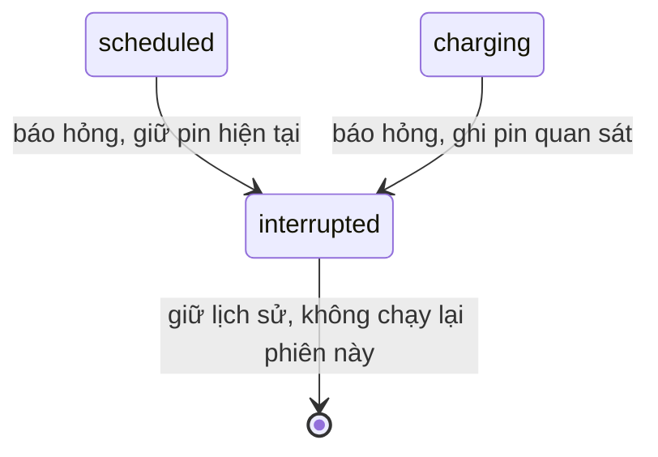
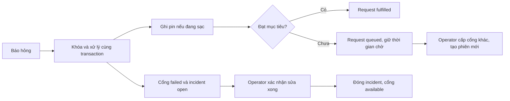

# T20 — sự cố cổng sạc và khôi phục hàng chờ

Trạng thái: triển khai local trên nhánh t20/charging-failure-recovery, kế thừa T19 8ee56ab. Chờ peer review và tích hợp; chưa triển khai production.

## Cách dùng

Đăng nhập operator, mở **Sự cố cổng sạc**, chọn Hub/cổng từ database. Nhập mô tả và bấm **Báo hỏng cổng và xử lý phiên**.
Nếu cổng có phiên charging, bắt buộc nhập pin quan sát được từ mức pin hiện tại tới 100%; giao diện gửi kèm đúng ID phiên đang thấy. Phiên scheduled chưa chạy không nhập hoặc tự tăng pin.
Cổng chuyển failed. Phiên đang hoạt động chuyển interrupted, có ended_at, không ghi completed chỉ vì cổng hỏng.
Nếu pin đã đạt mục tiêu, request fulfilled; nếu chưa đạt, request queued và giữ nguyên created_at, required_by, ID để tiếp tục ưu tiên theo thời gian đã chờ.
Operator vào Điều phối sạc chọn Hub để phân bổ lại sang cổng khác còn trống. Không tự cấp lại vào cổng hỏng và không tự chạy vòng lặp phân bổ.
Sửa, kiểm tra cổng rồi bấm **Xác nhận đã sửa xong**: đóng các incident đang open của cổng và đưa cổng failed về available. Không tự bật lại phiên cũ, sửa pin hay đổi trạng thái request trong bước sửa xong.

## Quy tắc an toàn

- Chỉ operator được đọc/quản lý danh sách cổng sự cố. Backend quyết định quyền ở controller, không dựa trên ẩn nút UI.
- Báo hỏng, pin, xe thuê, phiên, request và incident dùng một transaction. Lỗi ở bất kỳ bước nào rollback toàn bộ, gồm cả idempotency record.
- Thứ tự khóa: Hub → xe (nếu có) → request → point → session → incident. Với repair không còn phiên: Hub → point → incidents. Xóa cổng và phân bổ cũng khóa cùng Hub/point.
- Sự cố thuộc operations: ChargingIncidentService/OperationsRepository ghi và đóng incident bằng PoolClient caller. Cổng/phiên/request/pin cá nhân thuộc mobility. Pin/trạng thái xe thuê cập nhật qua RentalChargingService, không tự ghi vehicles từ module khác.
- ChargingIncidentModule là module lá, không import mobility hoặc rental, tránh vòng phụ thuộc khi OperationsModule gọi ChargingFailureService.
- Không sửa/thêm migration: dùng failed, interrupted, queued, fulfilled và bảng hiện có.
- Yêu cầu còn queued chưa giữ xe thuê, giống T19: sau gián đoạn, trả xe charging về available và ghi pin quan sát. Xe vẫn phải đủ pin, Hub active và không có reservation/trip mới để được thuê/phân bổ lại. Nếu xe được dùng trước khi cấp lại, request không đủ điều kiện bị loại khỏi danh sách ưu tiên; operator vẫn có thể hủy queued.
- Xe cá nhân vẫn chiếm chỗ đỗ sau gián đoạn. Check-out khi request queued tự hủy request như trước.
- Nếu pin/ID phiên trên form đã cũ do hoàn tất hoặc đổi phiên đồng thời, trả 409/400 mà không áp pin cho xe khác. Làm mới rồi báo lại cổng nếu vẫn hỏng; không tự replay mutation với dữ liệu pin cũ.
- Cổng có open incident không được cấp hoặc bắt đầu phiên mới kể cả dữ liệu trạng thái cũ vẫn available/occupied.
- Incident hỏng xe/Hub không nằm trong phạm vi T20 này. Không tự kết thúc trip hoặc khôi phục xe maintenance.

## API

Các endpoint bên dưới dùng session cookie operator; ID UUID. POST mới cần Idempotency-Key 1–128 ký tự.

| Method | Đường dẫn                                 | Body / kết quả                                                                                                       |
| ------ | ----------------------------------------- | -------------------------------------------------------------------------------------------------------------------- |
| GET    | /api/mobility/charging/points             | Danh sách cổng thực, Hub, trạng thái, phiên/xe/pin hiện tại và incident mở                                           |
| POST   | /api/mobility/charging/points/:id/fail    | {description,sessionId?,achievedBatteryPercent?}; trả pointId, failed, incident, interruptedSessionId, requestStatus |
| POST   | /api/mobility/charging/points/:id/recover | {}; trả {pointId,status:"available"}                                                                                 |

Pin và sessionId bắt buộc cho phiên charging. Pin không được thấp hơn pin hiện tại hoặc vượt 100. Với scheduled/no-session không gửi achievedBatteryPercent. Nếu gửi sessionId phải khớp phiên đang hoạt động ở cổng.
Cùng key và payload trả kết quả đã lưu, không ghi pin/incident lần hai; đổi payload với cùng key bị 409. Sau rollback có thể dùng lại key để thử lại.
401 chưa đăng nhập; 403 sai quyền; 400 sai dữ liệu/key/pin; 404 cổng/sự cố không có; 409 trạng thái/phiên đã đổi hoặc xung đột.

### Tích hợp API sự cố cũ

POST /api/incidents với resourceType charging_point đi qua cùng transaction T20, vẫn trả Incident theo contract cũ. Body có thể thêm sessionId và achievedBatteryPercent; khi phiên charging thì bắt buộc đúng phiên và pin. Thiếu dữ liệu bị từ chối, không ghi nửa sự cố.
POST /api/incidents/:id/resolve với incident cổng sạc đi qua repair T20; chỉ đóng incident được chọn. Cổng chỉ available sau khi không còn incident open nào và không còn phiên active. Resolve lại cùng incident không có key trả 409 như trước.
Các client cũ có thể bỏ Idempotency-Key ở API incidents; khóa Hub/point và tái sử dụng incident open tránh nhân đôi tác động. Key được hỗ trợ nếu truyền. Sự cố vehicle/hub giữ workflow cũ và từ chối field pin/phiên không liên quan.
Endpoint recover mới xác nhận sửa toàn cổng nên đóng tất cả incident open của cổng đó; không áp dụng cho incident loại khác.

## Vòng đời

## Kiểm chứng

tests/charging-failure-check.mjs chạy trên PostgreSQL/HTTP cô lập trong foundation: quyền, DTO/pin/session stale, replay/key conflict, scheduled/charging/idle point, pin đạt mục tiêu, giữ thời điểm chờ và cấp lại cổng khác, incident API cũ, lỗi ghi incident/repair rollback, 5 vòng fail/allocate, 3 vòng fail/complete và fail/delete.
Kiểm thử hook UI: operator-only, payload pin/phiên, retry key, repair và logout trong lúc mutation đang chờ.
Kết quả đầy đủ tại docs/testing.md. Chưa kiểm tra thiết bị thật hoặc demo trình duyệt toàn luồng ở nhánh này.

## AI

Codex hỗ trợ triển khai, kiểm thử và tài liệu theo yêu cầu Mai Anh. Thành viên cần hiểu giao dịch dữ liệu, ưu tiên hàng chờ và xử lý xung đột trước peer review/bàn giao.
