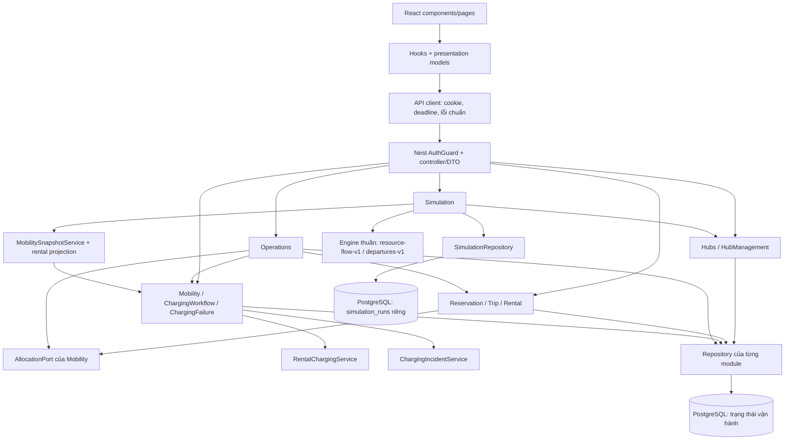
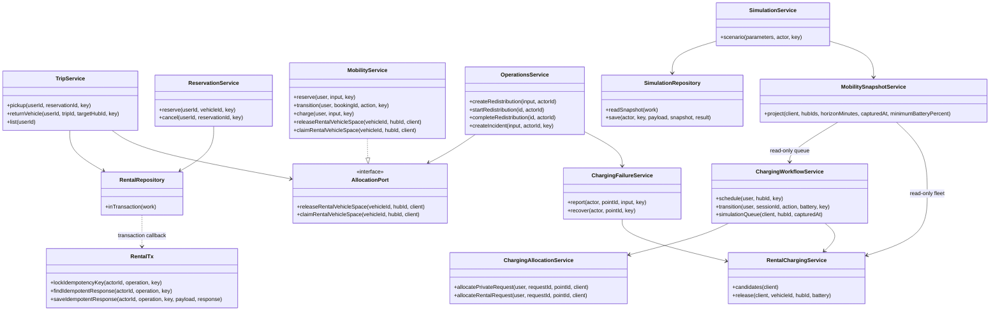
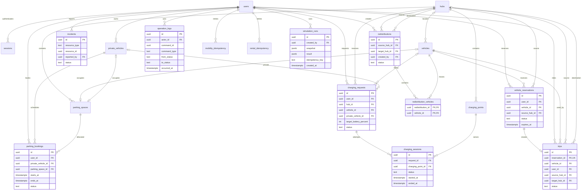
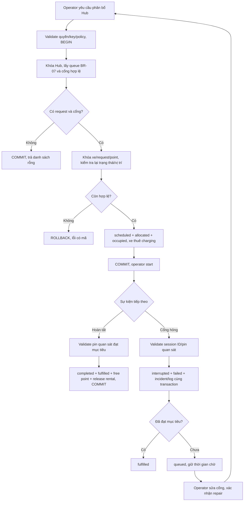
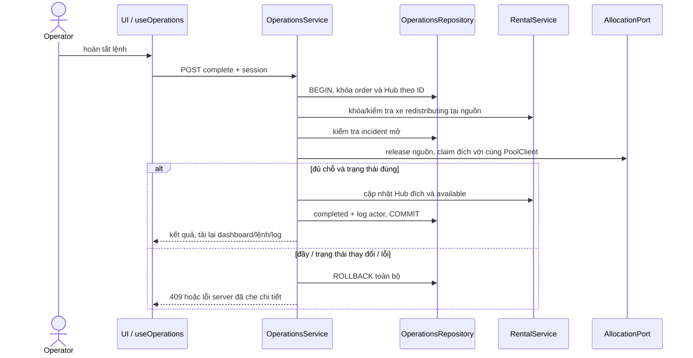
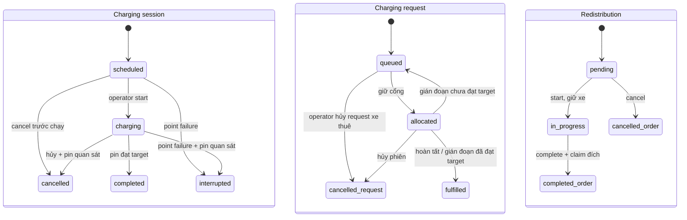

# Thiết kế tích hợp đối chiếu code ngày 28/10/2026

Các sơ đồ mô tả bản main `376b160` và kiểm thử ứng viên T23/T29. Source sự kiện/SQL tại `apps/api/src` và `database/migrations`; sơ đồ UC theo hai file PlantUML cùng thư mục. Pin quan sát có đơn vị %, thời gian API UTC, sức chứa là số chỗ/cổng thực.

## Các module và hướng phụ thuộc

AuthGuard chạy trước DTO/controller. Các cạnh nghiệp vụ cần nguyên tử dùng cùng PoolClient, không gọi HTTP nội bộ. Snapshot sử dụng một REPEATABLE READ READ ONLY; lưu run là transaction riêng, không có cạnh từ Engine về vận hành.

## Class diagram ở mức thiết kế

Đây là dependency giữa service stateless, không gán multiplicity domain vào các dependency. Multiplicity entity và FK nằm trong ERD bên dưới. Phương thức/class đại diện đã đối chiếu source; sơ đồ không liệt kê mọi controller/repository.

## ERD toàn hệ thống

Cột nền tảng users/sessions/hubs/vehicles/parking_spaces/charging_points/settings tại ERD trong architecture.md. `resource_id`/`command_id` đa hình do service kiểm tra, không có FK đa bảng. Mỗi charging_request có đúng một loại xe; một chỗ occupied chứa đúng một loại xe. Hệ số `o{` ở redistribution_vehicles phản ánh FK cho phép zero row trong transaction, service bắt buộc input không rỗng. Snapshot không FK Hub để history vẫn đọc được sau xóa/đổi tài nguyên. Key chống lặp scope actor + operation cho rental/mobility, actor + key cho simulation.

## Activity: phân bổ, chạy và xử lý hỏng cổng

Bước failed/gián đoạn không tự tăng pin hoặc tự chạy lại phiên cũ. Priority là hàm thuần, ngưỡng từ settings. Trình tự khóa cụ thể ở allocation-safety.md và charging-failure-recovery.md.

## Sequence: hoàn tất điều chuyển

## State: phiên sạc, request và lệnh

Vòng đời reservation/trip và sequence nhận/trả tại architecture.md. Không có cạnh in_progress → cancelled hoặc interrupted → charging: yêu cầu được phân bổ thành phiên mới.
