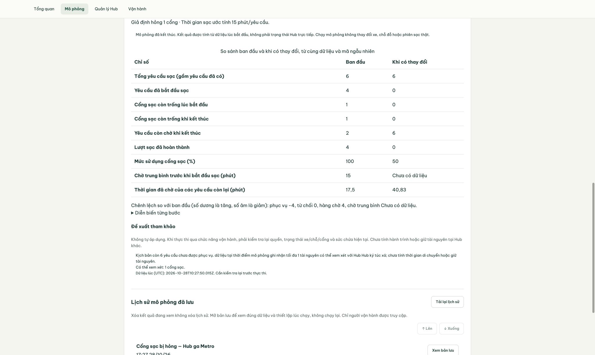

# Smart E-Mobility Hub — báo cáo hệ thống

Bản bàn giao kỹ thuật ngày 29/10/2026, đối chiếu main `376b160` và ứng viên `codex/week2-week3-delivery`. Thành viên: Minh Tường (lead/nền tảng/tích hợp), Duy Tân (thuê xe), Mai Anh (đỗ/sạc), Quỳnh Anh (Hub/vận hành), Minh Khuê (simulation). Báo cáo này tổng hợp công việc T24, cung cấp nội dung cho T30; không ghi nhận thay xác nhận đọc/giải thích của từng thành viên.

## 1. Bối cảnh, mục tiêu và ranh giới

Hệ thống điều phối xe điện dùng chung, chỗ đỗ và cổng sạc trong khu đô thị ĐHQG–HCM. Sinh viên cần tìm phương tiện đủ pin, giữ xe, nhận/trả, hoặc đăng ký xe cá nhân để đặt đỗ và yêu cầu sạc. Người vận hành cần thấy trạng thái toàn mạng, phân bổ cổng theo ưu tiên, xử lý hỏng và điều chuyển xe. What-if giúp đánh giá tình huống giả định trước quyết định vận hành.

Phạm vi triển khai là web, REST API, PostgreSQL và simulator TypeScript. Dữ liệu giả lập qua seed có cấu hình; trạng thái hiển thị lấy từ database qua service. Không có thanh toán, IoT thật, mobile riêng, bản đồ 3D hoặc dự báo ML. Seed chỉ khởi tạo, không chạy thay vòng đời vận hành. Đây là lựa chọn phạm vi của nhóm, không diễn giải thành yêu cầu loại trừ của đề bài.

Nguồn đối chiếu là `Assignment_SoftwareEngineering_HK261.pdf` (mô tả bài toán) và `Guideline and Rubric.pdf` (cấu trúc báo cáo, yêu cầu UML/test/AI và demo quay sẵn). Hai file được giữ local theo .gitignore, không đưa bản sao lên repo public. Chi tiết nộp và lịch bảo vệ do giảng viên thông báo sau, không suy ngày nộp chính thức từ lịch nội bộ.

## 2. Phân tích yêu cầu

### 2.1 Actor và stakeholder

Sinh viên sở hữu reservation/trip/xe cá nhân/lịch đỗ của mình. Operator quản lý tài nguyên chung, điều phối sạc, sự cố, lệnh và simulation. Đơn vị quản lý khu đô thị là stakeholder theo dõi hiệu quả sử dụng; không tạo role riêng chưa có trong code. Giảng viên và nhóm phát triển đánh giá khả năng truy vết yêu cầu–thiết kế–test. Database, đồng hồ và scheduler là thành phần bên trong ranh giới hệ thống.

### 2.2 Chức năng và truy vết

| Yêu cầu                        | Thực hiện trong bản tích hợp                                                           | Use case / bằng chứng tự động                                         |
| ------------------------------ | -------------------------------------------------------------------------------------- | --------------------------------------------------------------------- |
| FR-01 trạng thái Hub/dashboard | HubsService tổng hợp DB, hook polling cấu hình, timestamp và cảnh báo stale            | UC-02/11; foundation, dashboard-check, dashboard.test                 |
| FR-02 tìm xe                   | Lọc Hub/loại/pin, ngưỡng tối thiểu từ settings, loại xe có incident                    | UC-03; rental-search, rental-hardening                                |
| FR-03 giữ/hủy/hết hạn          | Transaction, khóa xe, active unique, worker hết hạn và kiểm tra hạn khi nhận           | UC-04; reservation, reservation-expiry                                |
| FR-04 nhận/trả                 | TripService và AllocationPort cùng transaction, history, gợi ý đích khi đầy, chống lặp | UC-05/06; trip, rental-hardening, release-check                       |
| FR-05 xe cá nhân/đỗ            | Owner từ session, lịch [start,end), check-in/out tách vị trí vật lý                    | UC-07/08; mobility-check, allocation-safety-check                     |
| FR-06 yêu cầu/phiên sạc        | Hàng chờ xe cá nhân và xe thuê, cấp cổng/start/complete/cancel                         | UC-09/10; charging-workflow-check, rental-charging-check              |
| FR-07 ưu tiên sạc              | Chống chờ lâu, cần xe sớm, pin thấp và tie-break ổn định từ policy                     | UC-10; charging-priority.test                                         |
| FR-08 Hub/tài nguyên           | CRUD, cấu hình capacity, bảo vệ hold/booking/incident/session                          | UC-12; hub-management-check/test                                      |
| FR-09 sự cố                    | Cổng hỏng gián đoạn/requeue/repair nguyên tử; incident xe chặn cấp mới                 | UC-13; charging-failure-check, operations, rental-hardening           |
| FR-10 điều chuyển              | Tạo/start/complete, chỉ hủy pending, kiểm tra nguồn/đích và log cùng transaction       | UC-14; operations.test, release-check                                 |
| FR-11 mô phỏng                 | Snapshot chỉ đọc và ba kịch bản, version/seed, kết quả lưu riêng                       | UC-15; scenarios.test, scenarios-check                                |
| FR-12 đánh giá/đề xuất         | Baseline/scenario/timeline, impact, recommendation theo tài nguyên snapshot            | UC-15; scenarios.test, release-check (revalidation lệnh thủ công)     |
| FR-13 xác thực/quyền           | Cookie session, role/active backend mỗi request, owner tại service                     | UC-01 và các luồng; foundation, release-check, test owner theo module |

Đặc tả actor, trigger, tiền/hậu điều kiện, ngoại lệ và liên kết BR/IT cho 15 UC nằm trong [use-cases.md](../use-cases.md). Hai sơ đồ bắt buộc: [sinh viên](../diagrams/use-cases-student.puml), [operator](../diagrams/use-cases-operator.puml). Không dùng một sơ đồ lớn cho mọi luồng.

### 2.3 Yêu cầu chất lượng

| Mã               | Tiêu chí kiểm chứng                                                                  | Kết quả và giới hạn                                                                      |
| ---------------- | ------------------------------------------------------------------------------------ | ---------------------------------------------------------------------------------------- |
| NFR-01 nhất quán | Không cấp trùng trong các race được thử; rollback không để trạng thái nửa chừng      | Có PostgreSQL/HTTP tests và assertion sau commit; không chứng minh mọi interleaving      |
| NFR-02 bảo mật   | 401/403 phía server, owner, cookie flags, Origin, revoke/expiry, không lộ secret 5xx | Có tests; không gọi đây là penetration test hoặc audit bảo mật toàn diện                 |
| NFR-03 hiệu năng | Mục tiêu đề xuất p95 ≤1s, 20 người dùng, 30 Hub/300 xe, 5 phút                       | Chưa chạy tải này; chưa công bố đạt. Polling lấy chu kỳ cấu hình, chưa có SLO production |
| NFR-04 sử dụng   | Loading/error/empty, phản hồi mutation, trạng thái stale, điều hướng theo role       | Có hook tests và Chrome smoke; chưa nghiên cứu usability với người dùng độc lập          |
| NFR-05 bảo trì   | UI → hook/model → API → service/domain → repository                                  | Review các ranh giới thay đổi; build/typecheck/format pass theo execution log            |
| NFR-06 tái lập   | Cùng snapshot/params/limits/seed/model cho cùng kết quả                              | Engine tests với 60 seed và fixtures biên; key mới có thể lấy snapshot khác              |

### 2.4 Quy tắc nghiệp vụ

[Business rules](../business-rules.md) chứa baseline BR-01–15, trạng thái phê duyệt và đánh đổi. Các invariant trọng yếu: một xe chỉ có một reservation active; chỗ vật lý và lịch là hai khái niệm; cổng failed không nhận phiên; mỗi point/request có tối đa một phiên active; pin quan sát không được tự tạo từ UI; sai quyền/trạng thái bị chặn; gửi lặp theo contract không tạo hiệu ứng lần hai. Module dùng service của owner với cùng PoolClient để giữ nguyên tử.

Các giới hạn bảo thủ được giữ công khai: xe chưa check-out vẫn chiếm chỗ; không hứa chỗ bị chiếm/giữ chưa biết giờ rời; recommendation không giữ tài nguyên và không tự thực thi. Đích đầy hoặc xe đã reserved lúc thực hiện phải bị từ chối, dù snapshot cũ cho phép.

## 3. Thiết kế hệ thống

### 3.1 Kiến trúc và lựa chọn

[Architecture](../architecture.md) và [thiết kế tích hợp](../diagrams/integrated-design.md) có sơ đồ module cụ thể, class, ERD, activity, sequence và state. Web React gọi REST NestJS qua API client có cookie/deadline. Components/pages hiển thị props và nối handler. Hooks quản lý trạng thái giao diện, gọi client; models chứa kiểu trình bày. Backend controller validate DTO, guard xác thực, service/domain quyết định nghiệp vụ/quyền, repository thực thi SQL. Utils là hàm thuần.

Một backend theo module phù hợp nhóm năm người: transaction chung dễ ghép, cùng TypeScript cho FE/BE/simulator, contracts dùng chung. So với microservice, giảm điều phối triển khai và distributed transaction; đánh đổi là phải review migration và ranh giới module chung. PostgreSQL phù hợp FK, partial unique, exclusion constraint và row locks; `pg`/SQL tường minh dễ đối chiếu với ERD, nhưng nhóm tự chịu trách nhiệm lock order/migration. Vite phục vụ web local, chưa có production hosting/SLA.

TripService gọi AllocationPort để trả/nhận. Operations gọi RentalService và AllocationPort, không tự sửa bảng của owner. Charging dùng RentalChargingService để giữ/nhả xe thuê; ChargingIncidentService ghi incident/log trong transaction của caller. Simulation đọc snapshot qua service owner, engine không gọi database hoặc random toàn cục; chỉ repository simulation ghi history riêng.

### 3.2 Cấu trúc dữ liệu và lớp

ERD nền tảng trong architecture.md có users/sessions/hubs/vehicles/private_vehicles/parking_spaces/charging_points/settings. ERD tổng hợp bổ sung reservation/trip, booking, requests/sessions, incident/redistribution/items, operation_logs, hai bảng idempotency và simulation_runs. FK và cardinality theo migration SQL; resource_id/command_id đa hình được service kiểm tra, không gắn FK giả. PIN integer 0–100, thời gian timestamptz và API ISO 8601 UTC.

Class diagram chỉ ra TripService/ReservationService, RentalRepository/RentalTx, AllocationPort/MobilityService, OperationsService và các service charging/simulation. Đây là các lớp thực được Nest inject; bảng entity không được dùng thay class diagram. Partial unique ngăn hai reservation active hoặc hai session active; exclusion `[)` ngăn lịch overlap theo xe/chỗ và cho phép tiếp giáp.

### 3.3 Hành vi quan trọng

Nhận xe kiểm tra owner, expiry ngay tại transaction, Hub, pin, incident và chỗ nguồn; tạo trip/fulfilled/in_use và giải phóng chỗ cùng commit. Trả xe khóa trip, Hub đích và xe, gọi allocation; đầy thì rollback, trip vẫn active, gợi ý không giữ chỗ.

Phân bổ sạc xếp queue BR-07 từ settings, khóa/kiểm tra lại tài nguyên và tạo scheduled/allocated/occupied. Xe thuê chuyển charging khi giữ cổng, không đợi start. Hoàn tất cần pin quan sát đạt target; cổng được nhả cùng request/xe. Hỏng trong phiên tạo interrupted/failed/incident/log nguyên tử, nhu cầu chưa đạt quay queued với thời gian chờ cũ; repair không hồi sinh session cũ.

Điều chuyển pending chưa di chuyển xe. Start giữ xe redistributing. Complete xác minh lại nguồn/đích/sự cố, release nguồn + claim đích + cập nhật xe/order/log cùng transaction. Đích đầy giữ in_progress và chỗ nguồn do rollback; không hủy in_progress tùy ý. Activity/sequence/state tương ứng tại [sơ đồ tích hợp](../diagrams/integrated-design.md).

### 3.4 Giao diện và phản hồi

Sinh viên thấy Hub active, pin, khả dụng, form xe cá nhân/đỗ/sạc, tìm xe, reservation và mọi trip active/history. Operator có thêm Quản lý Hub, Vận hành và Mô phỏng; dashboard tổng hợp toàn mạng và điều phối/gián đoạn sạc. Quyền UI giúp điều hướng, backend tiếp tục kiểm tra từng request.

Polling có timestamp và stale notice. Lỗi tạm giữ dữ liệu thành công trước đó; đổi danh tính/quyền xóa cache và yêu cầu đăng nhập lại. Form mutation giữ dữ liệu khi thất bại; request của tài khoản cũ không ghi vào UI mới. Gợi ý đích đầy và thông báo pin/phiên đã đổi giúp người dùng sửa thao tác. Các màn hình thực trong [bằng chứng Chrome](../../demo/evidence/week23/) minh họa luồng, không thay test data assertions.

Ví dụ một snapshot demo: demand6, served4→0 và queue2→6 khi giả hỏng cổng còn nhận việc; đây là mô hình thử, không phải đo nhu cầu thật.

### 3.5 What-if và phối hợp vận hành

T22 dùng resource-flow-v1: `demand_surge`, `parking_full`, `charging_failure`. Horizon/step nguyên phút chia hết, seed uint32, rate yêu cầu/bước, parking thêm số chỗ và charging chọn cổng hỏng/service time. Limits từ settings được validate, không fallback sang kết quả giả. T13 departures-v1 vẫn tồn tại riêng để so sánh bản đơn giản.

Snapshot chung REPEATABLE READ READ ONLY gồm Hub/xe/chỗ/cổng, booking/session/queue và rental projection hợp lệ theo service owner. Timestamp do transaction DB cấp. Chỗ có lịch giao horizon bị loại suốt run; không đoán giờ rời. Baseline/scenario dùng cùng seed LCG và snapshot. Engine thuần sinh arrivals theo phân phối được mô tả trong [scenarios.md](../scenarios.md), không nhận đây là mô hình nhu cầu đã hiệu chuẩn.

Thuê/parking: demand = served + unserved, tài nguyên không âm. Charging: demand = served + queued, completed ≤ served; utilization là busy-point-minutes trên tổng installed-point-minutes, wait chỉ tính mẫu được cấp trong horizon. Các đại lượng không áp dụng trả null. Impact là scenario trừ baseline; không suy mọi chỉ số phải tăng khi tăng nhu cầu.

Khi thiếu tài nguyên, recommendation dựa vào Hub khác active, xe đủ điều kiện/chỗ/cổng trong snapshot và giới hạn thiếu hụt. Không có lựa chọn thì review_capacity, không hứa số cổng xây mới. Một nguồn/đích để tránh hứa trùng. Operator tham khảo rồi tạo lệnh riêng qua workflow hiện tại; server revalidate. Không có nút tự áp dụng, không mô phỏng hiệu quả sau điều phối, thời gian đi/hao pin hoặc năng lượng thật. History lưu snapshot/parameters/limits/version/result/actor riêng; cùng key trả bản cũ, mở history không chạy engine lại.

## 4. Hiện thực

React + TypeScript + Vite; NestJS + TypeScript; PostgreSQL qua `pg`; workspace npm và contracts dùng chung. Môi trường thực của lần kiểm tra ghi trong execution log; lockfile pin phiên bản giải quyết dependencies. Scripts setup tạo secret ngẫu nhiên vào .env bị ignore; source public chỉ có .env.example. Migration theo toàn tên file, giữ nguyên hai migration tiền tố 007 đã chia sẻ.

Các quyết định đáng chú ý: opaque session token HttpOnly/SameSite Strict và hash SHA-256 trong DB; password scrypt/salt; Origin check cho mutation; login rate limit có cấu hình; lỗi 5xx che chi tiết. Deadline client giúp UI phục hồi, không chứng minh server hủy mutation; không tự replay mutation không có contract idempotency. Reservation/trip, mobility/charging và simulation có scope key theo API; điều chuyển không có contract retry key.

Không thay model/UI để đạt demo bằng dữ liệu cố định. Test fixture có thể dùng SQL để tạo trạng thái biên trên DB riêng, nhưng thao tác được kiểm tra đi qua HTTP/service thật. `tests/release-check.mjs` bổ sung chuỗi một xe xuyên rental/charging/failure/redistribution, ma trận quyền 32 route families và lệnh từ dữ liệu cũ bị revalidate.

## 5. Kiểm thử và xác minh

### 5.1 Kế hoạch, tổ chức và kỹ thuật

[Kế hoạch tích hợp](../integration-test-plan.md) chứa 36 testcase IT-01–36, traceability FR/UC/BR, dữ liệu, entry/exit, mức test và người phụ trách. Execution được ghi riêng để không biến kế hoạch thành pass. Owner kiểm tra module, lead kiểm tra ranh giới; xác nhận kiểm thử chéo của sinh viên là bước riêng.

Dùng partition/decision table cho DTO/quyền; boundary cho pin/thời gian/capacity; state-transition cho reservation/trip/session/order; concurrency cho đặt/nhận/trả/allocate/incident/delete; fault injection trong test để kiểm tra rollback; model-based cho conservation, seed và recommendation. Test backend chạy HTTP thật/PostgreSQL tạm, frontend Vitest/jsdom kiểm tra hooks/client và phiên cũ, Chrome smoke kiểm tra UI thực.

### 5.2 Kết quả thực

[Execution ngày 28/10](../test-runs/2026-10-28-release.md) là nguồn số test và lệnh thực thi. Baseline trước thay đổi có 126 backend và 62 frontend tests pass. Ba regression T23/T29 mới đã pass riêng trong foundation suite; bổ sung regression shutdown demo W23-R01 cũng pass. Kết quả cài mới qua `npm run verify:delivery` là 130 backend + 62 frontend pass, 0 fail; cài dependency/setup/format/build cũng pass. Thư mục sạch trên cùng host, không tuyên bố là máy vật lý khác.

Bằng chứng chuỗi tích hợp kiểm tra một xe trở về đúng Hub, đúng một chỗ, pin quan sát 90% sau hoàn tất, charge request fulfilled, operation log đúng actor; gửi lặp không tạo hiệu ứng lần hai. Snapshot/history giữ nguyên, start dispatch khi xe đã reserved trả 409; complete khi đích đầy rollback và không log completed giả. Ma trận operator kiểm tra 32 method/path families × anonymous/student = 64 responses, đây là assertions trong một test, không tính thành 64 tests độc lập.

Ngày 29/10, Playwright Chromium trên DB tạm đã xác minh năm luồng UI: thuê/trả, đăng ký/đặt đỗ/check-in/out đúng giờ thật, sạc gián đoạn/requeue/repair/phiên mới/hoàn tất, điều chuyển và ba scenario. Đã đọc cả ba TXT tải xuống, mở history và đối chiếu Hub không đổi. Bằng chứng tại demo/evidence/week23/recorded-ui-verification.json; W23-E01 đã đóng. Build và 130 backend + 62 frontend tests pass khi chạy lại cùng ngày. CI Ubuntu/Node 22 của commit 5ae8381 cũng pass; bước UI mới có artifact riêng trong workflow. Chưa chạy load target NFR-03, pentest, thử nhiều thiết bị hoặc chứng minh toàn bộ tổ hợp trong 36 case. [Coverage map](../test-runs/2026-10-28-traceability.md) ghi các phần được kiểm chứng và phần chưa đủ oracle.

### 5.3 Defect và giới hạn kiểm chứng

[Defect log](../defects.md) giữ lịch sử, phân biệt lỗi tái hiện, tài liệu lỗi thời, giới hạn đã công bố và việc chưa xác minh. Đợt này sửa các mô tả “chưa có” của T19/T21/T22 và sơ đồ UC, bổ sung regression xuyên module. Không ghi số defect ứng dụng bằng không để suy không còn lỗi; chỉ nói không có lỗi chặn được quan sát trong tập kiểm tra thực thi.

## 6. Đánh giá, hạn chế và bàn giao

Các luồng cốt lõi đã có trong bản tích hợp, gồm ba kịch bản What-if và service revalidation khi tài nguyên thay đổi. Ranh giới module với transaction chung giúp giữ tính nhất quán và kiểm thử trên HTTP/DB. Đánh đổi chính là simulation đơn giản, deployment local và operator chủ động xác nhận sạc/di chuyển.

Giới hạn còn công khai: không hao pin/telemetry; không tự phân bổ sạc theo thời gian; chưa cứu hộ trip hoặc tự hủy cam kết khi Hub inactive; incident xe/Hub không tự đổi maintenance/inactive; lệnh đang chạy không hủy; chưa audit mọi CRUD Hub; chưa phân trang mọi danh sách; model chưa hiệu chuẩn; chưa đo tải NFR-03; đã có build/test trên CI Ubuntu riêng, chưa có nghiệm thu sử dụng trên máy vật lý của thành viên khác. Không đưa các mục này thành feature mới trong gate freeze, trừ sửa lỗi chặn có bằng chứng và regression.

Bài học kỹ thuật rút từ log tích hợp: khóa theo thứ tự chung giữa module, kiểm tra lại sau chờ lock, không giữ form pin cũ khi đổi phiên, và không đánh đồng seed với state vận hành. Hướng cải tiến sau phạm vi bài: telemetry, workflow cứu hộ/Hub ngưng hoạt động, đo tải và hiệu chuẩn mô hình, rollout production có HTTPS/backup/monitoring.

Bộ trình bày và lịch rehearsal nằm trong [bàn giao tuần 2–3](week2-week3-delivery.md). Tổng trình bày khoảng 20 phút gồm video demo quay sẵn khoảng 3 phút theo rubric. Video 180 giây và phụ đề đã được tạo từ các luồng UI thật, giọng đọc tổng hợp macOS Linh; lời dẫn tại demo-narration.md. Slide final gồm 10 trang và speaker notes. Báo cáo PDF có UML/ERD vector; các SVG chi tiết nằm trong docs/diagrams/rendered. Rehearsal, từng người hiểu phần mình và xác nhận nộp vẫn cần nhóm thực hiện, không lấy test của Codex thay cho các bằng chứng đó.

### 6.1 Khai báo Generative AI

Codex hỗ trợ triển khai, review kỹ thuật, tạo regression, chạy test/Chrome smoke, đối chiếu tài liệu và soạn báo cáo/slide theo yêu cầu Minh Tường. Các đợt trước được lưu ở [ai-usage.md](../ai-usage.md). Nhóm phải đọc, sửa, xác nhận số liệu và tự giải thích thiết kế/test/phần mình. Báo cáo không khẳng định sinh viên đã review hoặc nghiệm thu nội dung do AI soạn khi chưa có xác nhận.
